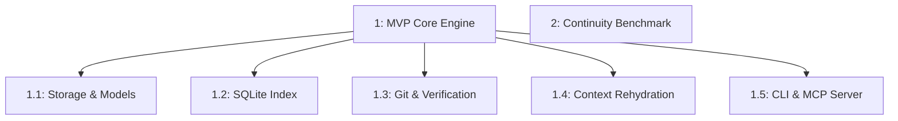

# Project memory tree

Generated snapshot of recorded project understanding: task goals, agreed approaches, inherited rules, references, and skills. This does not expose hidden model reasoning. Refresh after changing canonical memory.

| Task | Parent | Established approach sources | Modules |
|---|---|---|---|
| 1 |  | 1 | [AGENTS.md](tasks/1/AGENTS.md) · [SKILL.md](tasks/1/SKILL.md) |
| 1.1 | 1 | 1 | [AGENTS.md](tasks/1.1/AGENTS.md) · [SKILL.md](tasks/1.1/SKILL.md) |
| 1.2 | 1 | 1 | [AGENTS.md](tasks/1.2/AGENTS.md) · [SKILL.md](tasks/1.2/SKILL.md) |
| 1.3 | 1 | 1 | [AGENTS.md](tasks/1.3/AGENTS.md) · [SKILL.md](tasks/1.3/SKILL.md) |
| 1.4 | 1 | 1 | [AGENTS.md](tasks/1.4/AGENTS.md) · [SKILL.md](tasks/1.4/SKILL.md) |
| 1.5 | 1 | 1 | [AGENTS.md](tasks/1.5/AGENTS.md) · [SKILL.md](tasks/1.5/SKILL.md) |
| 2 |  | not recorded | [AGENTS.md](tasks/2/AGENTS.md) · [SKILL.md](tasks/2/SKILL.md) |
