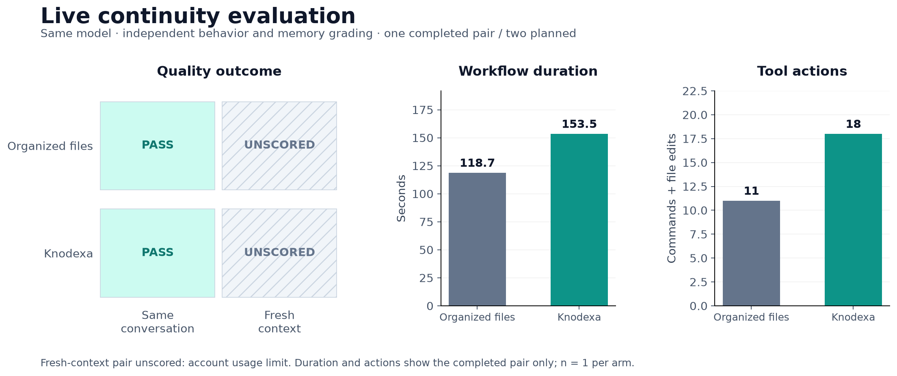
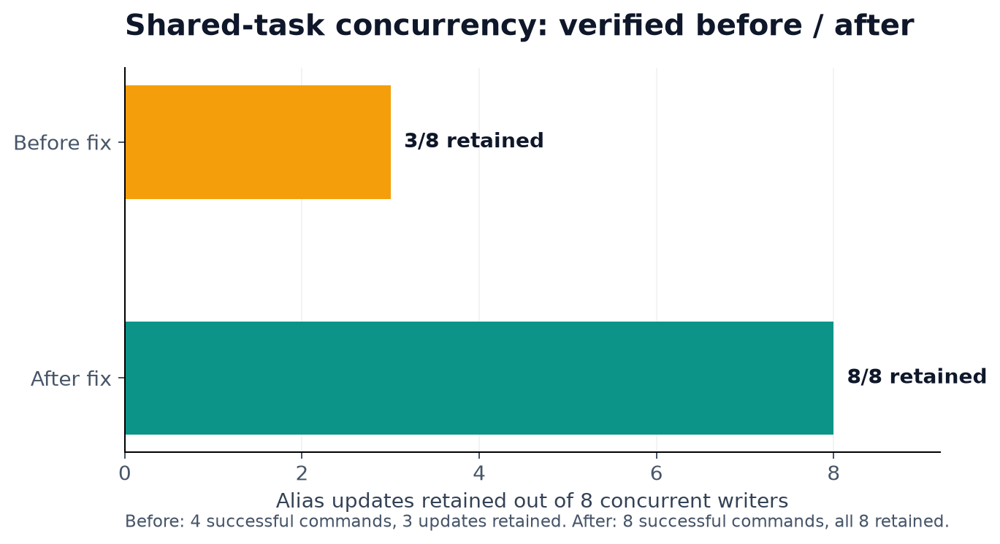
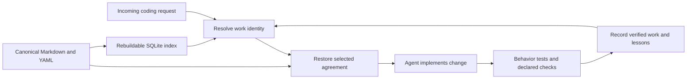

# Knodexa

[](https://github.com/PandiaJason/Knodexa/actions/workflows/ci.yml)


**Project memory and consistency checks for coding agents.**

Knodexa helps an agent return to established work after unrelated tasks or a fresh
context. It restores the relevant implementation agreement, constraints,
references, failures, and lessons—and checks declared rules before recording
verified work.

Local files are authoritative. The core makes **zero LLM calls**. Agents use the
same Go services through a CLI or MCP.

## Why it exists

An agent can build a handler correctly, spend several tasks following a different
pattern elsewhere, then return and silently change the original design. A long
transcript alone does not make the earlier agreement explicit or enforceable.

Knodexa makes continuity inspectable:

- **Resolve established work:** recorded phrases, file scopes, source symbols,
  and explicit relationships identify the relevant task.
- **Restore its agreement:** retain mandatory constraints and acceptance criteria,
  while treating transferred lessons as advisory.
- **Check declared drift:** reference hashes, literal checks, and Go AST checks
  produce concrete pass/fail reports.
- **Preserve history:** deliberate agreement changes require a reason; obsolete
  knowledge points to a verified replacement.
- **Coordinate task updates:** atomic alias merges retain concurrent additions;
  stale full-task replacements return a conflict.

Knodexa stores explicit project understanding, not hidden model reasoning.

## Evidence, not promises

<!-- release-results:begin -->
A fresh paired evaluation against **Codex with organized memory files** found:

| Scenario | Organized files | Knodexa |
|---|---|---|
| Return after unrelated work in the same conversation | Passed | Passed |
| Return in a fresh context | Unscored: account usage limit | Unscored: account usage limit |

The completed pair tied on independent behavior, source preservation, and
completed-memory preservation. Knodexa took **153.5 s / 18 tool actions**, compared
with **118.7 s / 11 actions** for organized files. One pair cannot establish a
general quality advantage.



[Methodology, raw metrics, grading artifacts, and limitations](audit/release-evaluation-v1/REPORT.md).
<!-- release-results:end -->

The separate integration audit observed three fresh Codex CLI agents restoring
agreements before editing, passing independent behavior checks, and preserving
completed parent memory. One agent found the skill through manual repository
search rather than automatic host loading.
[Host adoption evidence](audit/host-and-concurrency-v1/REPORT.md).

The concurrency audit first exposed lost updates and SQLite contention. After the
fix, all **8/8 public alias updates** and **8/8 atomic task updates** survived.
Seven conflicting full-record writes were explicitly rejected, rather than
reported as successful and silently lost.
[Before/after concurrency evidence](audit/host-and-concurrency-v2/REPORT.md).



## Quick start

Requires **Go 1.26 or later** to build. The resulting CLI is a single binary.

```sh
git clone https://github.com/PandiaJason/Knodexa.git
cd Knodexa
go build -o bin/knodexa ./cmd/knodexa
export PATH="$PWD/bin:$PATH"
knodexa help
```

From the project you want to manage:

```sh
knodexa init --name="My project"
knodexa agents install
```

The installer adds a managed protocol block to `AGENTS.md`, preserving unrelated
instructions. Configure your coding host to load project guidance and make the
CLI available in its environment.

### Establish an agreement after correct work

The following example assumes the reference implementation already exists and
its tests pass. Choose rules and paths appropriate to your project.

```sh
knodexa task create --id=delivery --title="Inbound webhook delivery" \
  --alias="webhook handler" --files=handlers/reference.go
```

Create `agreement.json`:

```json
{
  "aliases": ["webhook handler"],
  "files": ["handlers/reference.go"],
  "approach": {
    "summary": "Handlers delegate raw values to injected services",
    "rules": ["Preserve result and error identity"],
    "scopes": ["handlers/"],
    "references": [{"path": "handlers/reference.go"}],
    "checks": [{
      "path": "@touched",
      "ast_kind": "forbid-call",
      "symbol": "strings.TrimSpace"
    }]
  }
}
```

```sh
knodexa record delivery --file=agreement.json --verify='go test ./...'
```

### Return to related work

```sh
knodexa prepare "Add another webhook handler" --text
```

Inspect `needs_review`, selected work, baseline, constraints, and references.
Continue the matched work or create a related child with `--parent=delivery`.
Ambiguity requires an explicit choice; task names and recency do not establish
authority.

For a command-based agent, the opt-in guard bundles restoration and verification:

```sh
knodexa run "Add another webhook handler" \
  --verify='go test ./...' -- <agent-command> [arguments]
```

The command receives `KNODEXA_CONTEXT_FILE` and must read it. The guard checks the
agreement restored before execution, including new Go files in declared scopes.
Failed checks prevent identity capture; they do not undo file edits.

For an interactive agent, declare actual touched files, run behavioral tests, and
use `knodexa approach check <task-id> --json` before reporting success.

## Agent integrations

One maintained protocol is available in three formats:

```sh
knodexa agents install                         # AGENTS.md
knodexa agents install --format=skill          # Portable skill bundle
knodexa agents install --format=rules          # Generic RULES.md
```

Use `--path=relative/path` to select a host-supported location. For Codex's
repository skill discovery path:

```sh
knodexa agents install --format=skill \
  --path=.agents/skills/knodexa-continuity/SKILL.md
```

The default `skills/knodexa-continuity/` directory is a distribution bundle,
not a universal discovery location. Generic rules also require host configuration.
Inspect the protocol with `knodexa agents print`.

MCP clients can run `knodexa mcp` from the managed project root. The server exposes
19 tools for restoration, recording, evidence, agreements, identity, and knowledge
retirement. See [MCP configuration and tools](MCP.md).

## How memory works



| Memory | Role |
|---|---|
| Agreements, constraints, acceptance criteria | Mandatory context preserved under budget pressure |
| Decisions and reference implementations | Design rationale and inspectable precedent |
| Failures | Past mistakes and their resolution |
| Verified lessons | Advisory experience, ranked by relationship and file relevance |
| Deferred pointers | Expand retrieved details omitted for the context budget |

Canonical records live in `.knodexa/`; SQLite is a derived cache. `memory export`
renders a navigable memory tree and task instruction modules. Supersession retains
historical content, replacement provenance, and recorded invalidation time.

## Useful commands

| Command | Purpose |
|---|---|
| `prepare "<request>" --text` | Restore identity, baseline, agreement, checks, and references |
| `resume <id> --json` | Restore known work; completed sources remain completed |
| `record <id> --file=agreement.json --verify='<tests>'` | Verify and record agreement plus source identity |
| `approach check <id> --json` | Inspect declared consistency checks |
| `approach history <id>` | Inspect previous agreement versions |
| `supersede <D-id\|L-id> --by=<verified-id> --reason='<why>'` | Retire obsolete knowledge while retaining history |
| `show <D-id\|L-id> --json` | Expand rationale and evidence |
| `memory export` | Generate human-readable memory modules |
| `doctor --rebuild` | Rebuild and inspect the derived index |

Replacing an agreement requires `change_reason`. Refactored inherited references
use reviewed child-local bindings rather than rewriting completed ancestors.
[Reference reconciliation](audit/reference-reconciliation/REPORT.md).

## Limits

- Instructions work only when the host loads them and the agent follows them.
- Identity matching is deterministic lexical/file/source matching, not a general
  semantic classifier.
- Go AST and literal checks are structural evidence. Architectural quality still
  needs review and behavioral tests.
- Task update locks coordinate clients using Knodexa's APIs. Direct external edits
  and concurrent mutations of other knowledge-record types need separate handling.
- Recorded input-token totals include cached tokens; they are not unique context
  sizes or billing estimates.
- Current trials do not establish superiority over organized memory files or every
  memory product.

## Development and evaluation

```sh
./scripts/check.sh
```

Runs Go vet, race tests, and a freshly built standalone CLI smoke test. Ordinary
checks do not call a model or require an API key.

Live evaluation is opt-in and consumes authenticated Codex usage:

```sh
KNODEXA_LIVE_RELEASE=1 KNODEXA_RELEASE_OUTPUT=audit/my-evaluation \
  go test ./internal/experiment \
  -run '^TestLiveReleaseComparison$' -count=1 -timeout=40m -v
```

Existing evidence directories are protected against overwriting. Use a distinct
run directory when repeating an evaluation; retain failures and timeouts.

## Documentation

- [Product goals](PRODUCT.md)
- [Architecture](ARCHITECTURE.md)
- [Canonical storage](STORAGE.md)
- [CLI/MCP workflows](MCP.md)
- [Tests and evaluation](TESTING.md)
- [Evidence index](audit/README.md)
- [Memory-system research and adaptations](audit/memory-patterns/RESEARCH.md)

Bug reports and contributions should include a reproducible case, expected
agreement, actual behavior, and relevant verification output.
