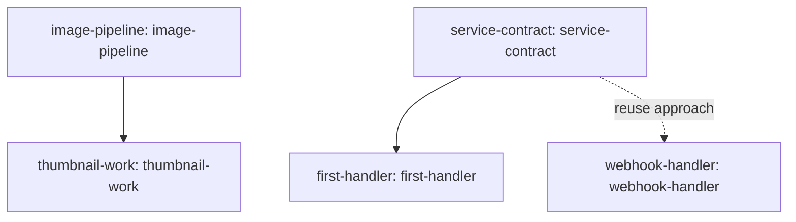

# Project memory tree

Generated snapshot of recorded project understanding: task goals, agreed approaches, inherited rules, references, and skills. This does not expose hidden model reasoning. Refresh after changing canonical memory.

| Task | Parent | Established approach sources | Modules |
|---|---|---|---|
| first-handler | service-contract | service-contract | [AGENTS.md](tasks/first-handler/AGENTS.md) · [SKILL.md](tasks/first-handler/SKILL.md) |
| image-pipeline |  | image-pipeline | [AGENTS.md](tasks/image-pipeline/AGENTS.md) · [SKILL.md](tasks/image-pipeline/SKILL.md) |
| service-contract |  | service-contract | [AGENTS.md](tasks/service-contract/AGENTS.md) · [SKILL.md](tasks/service-contract/SKILL.md) |
| thumbnail-work | image-pipeline | image-pipeline | [AGENTS.md](tasks/thumbnail-work/AGENTS.md) · [SKILL.md](tasks/thumbnail-work/SKILL.md) |
| webhook-handler |  | service-contract | [AGENTS.md](tasks/webhook-handler/AGENTS.md) · [SKILL.md](tasks/webhook-handler/SKILL.md) |
