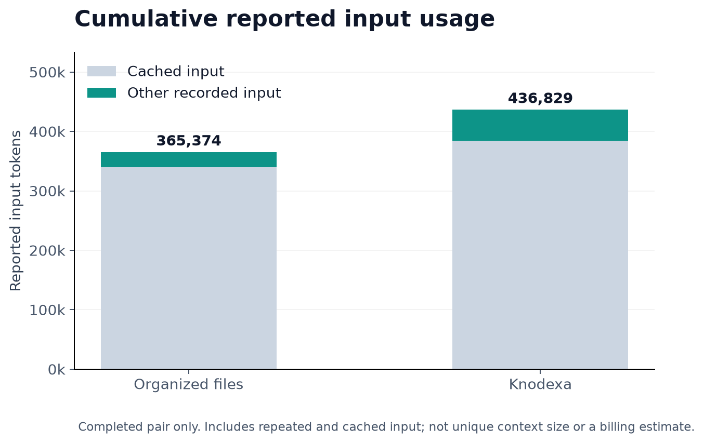

# Current-release live evaluation

Two paired scenarios were declared before execution. Both arms used the same
model (gpt-6.1-sol, low reasoning effort), explicit project instructions, recorded
work identity, and independently graded Go behavior. The baseline used organized
native memory files; Knodexa used the current Go CLI.

**Result: the completed pair tied on quality. Knodexa used more time and tool
actions. The other pair is unscored because the account usage limit interrupted
execution before the return task. No superiority is established.**


## Results

| Scenario | Organized files | Knodexa | Paired outcome |
|---|---|---|---|
| Same conversation: correct handler → unrelated image work → return | Passed independent behavior, source and completed-memory preservation | Passed the same checks | Tie |
| Fresh context after unrelated work | No scored return | No scored return | Unscored: account usage limit |

For the completed pair, metrics sum the agent phases for establishment, unrelated
work, and the return. Fixture setup and independent grading time are excluded:

| Metric | Organized files | Knodexa |
|---|---:|---:|
| Workflow duration | 118.75 s | 153.47 s |
| Tool actions | 11 | 18 |
| Cumulative reported input tokens | 365,374 | 436,829 |
| Of those, cached input tokens | 339,968 | 384,640 |

Knodexa took about **29% longer** and used **64% more tool actions** in this one
completed pair. This measures the workflow exercised here, not an intrinsic or
statistically established performance difference.



Reported usage includes repeated and cached input. It is not unique context size,
uncached-only consumption, or a billing estimate. Timings and usage from the
interrupted pair are retained in JSON/CSV but excluded from these comparisons.

## Method

- Predeclared order: organized files first for the shared-conversation case,
  Knodexa first for the fresh-context case.
- Each arm establishes a raw-value handler, records its agreement, implements an
  unrelated image-normalization utility, then returns to a related handler request.
- The return request supplies neither the original task ID nor its file path.
- Independent Go tests check raw-value delegation, result/error identity and
  observer behavior. Grading separately checks unchanged source references and
  completed source memory.
- Both producers must pass independent checks before a return is scored.
- Account-limit interruption stopped Knodexa during the fresh-case switch phase;
  the baseline's fresh-case establishment was also refused by the provider.
  Neither arm reached a scored return in that case.
- All declared cases were attempted. No failed case was selectively rerun,
  dropped, or recast as a quality failure.

This is one completed pair on one controlled programming task. There is no
statistical power to establish general coding quality, architecture preservation,
forced-compaction resistance, or superiority over other memory products. It also
does not benchmark every Codex internal tool or its account-level memory feature.

## Evidence and reproduction

- [Declared plan](plan.json)
- [Combined results](results.json), [summary](summary.json), [metrics CSV](metrics.csv)
- [Completed pair](same-conversation-return/results.json)
- [Interrupted pair](fresh-context-return/results.json)
- Per-arm independent test logs, producer memory, reference implementations and
  final source snapshots are retained alongside the metrics.
- Local JSONL agent session traces and stderr remain on the test machine and are
  excluded from Git publication. The provider interruption is recorded separately
  in [interruption.json](interruption.json).

Run from the repository root:

```sh
KNODEXA_LIVE_RELEASE=1 KNODEXA_RELEASE_OUTPUT=audit/my-evaluation \
  go test ./internal/experiment \
  -run '^TestLiveReleaseComparison$' -count=1 -timeout=40m -v
```

The test consumes authenticated Codex usage and protects existing output from
overwrite. Preserve prior evidence before selecting another run directory.
Ordinary validation skips paid model trials.

The chart data comes directly from the recorded results. PNG and SVG exports are
in `docs/assets/`. Charts were rendered offline with Matplotlib; plotting is not
a runtime or CI dependency of the Go application.

## What this means for the project

Knodexa has demonstrated restoration, explicit consistency checks, inspectable
knowledge history, and safe tested task-update operations. This experiment does
not show better coding quality than well-organized files. Reducing workflow
overhead and validating harder, replicated continuity cases are the next evidence
targets; adding more features alone will not establish an advantage.
