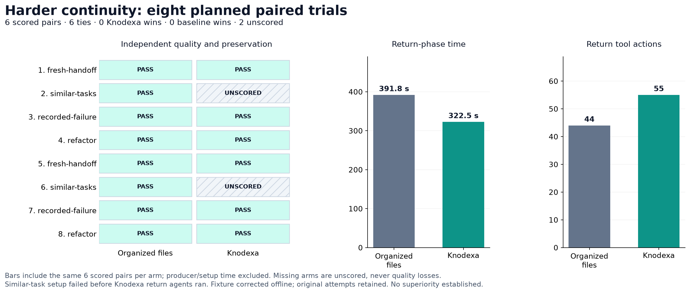

# Eight-pair live continuity audit

**No quality superiority demonstrated.** Of eight predeclared pairs, 6 tied, 0 favored Knodexa, 0 favored organized files, and 2 were unscored.



| Pair | Case | Organized files | Knodexa | Paired outcome |
|---|---|---|---|---|
| 1 | fresh-handoff | Passed | Passed | tie |
| 2 | similar-tasks | Passed | Unscored: setup failure | unscored |
| 3 | recorded-failure | Passed | Passed | tie |
| 4 | refactor | Passed | Passed | tie |
| 5 | fresh-handoff | Passed | Passed | tie |
| 6 | similar-tasks | Passed | Unscored: setup failure | unscored |
| 7 | recorded-failure | Passed | Passed | tie |
| 8 | refactor | Passed | Passed | tie |

## Comparable performance

The same 6 fully scored pairs are included on both sides. Unpaired native returns are retained in metrics.csv but excluded from comparative totals.

| Metric | Organized files | Knodexa |
|---|---:|---:|
| Passed returns in scored pairs | 6/6 | 6/6 |
| Return agent seconds (sum) | 391.76 | 322.46 |
| Return tool actions | 44 | 55 |
| Producer capture seconds (sum) | 228.24 | 204.71 |
| Producer capture tool actions | 33 | 68 |

Timings are observed agent wall time, not a statistically established latency difference. They exclude harness setup, CLI build and independent grading. All captures and returns are separately retained. Actions count reported command/file items, not every host operation. Raw token usage remains in phase/result JSON; cumulative repeated/cached usage is not unique context size.

## Predeclared method

- Eight pairs, two each: fresh-agent handoff, six similar task distractors, recorded observer failure, and refactored references. Every arm gets an independent producer capture followed by a fresh return session.
- Same gpt-6.1-sol model, low reasoning effort, background generated memories disabled, Go standard library, canonical requirements and independent graders. The initial correct handler is a fixed fixture; producers record it rather than author it.
- Baseline uses native Codex file/shell tools, an index, modular memory, explicit retrieval guidance, the same failures and cross-task lesson. Knodexa uses its current CLI. This is not a comparison against every internal Codex feature or other coding products.
- Native first on odd pairs, Knodexa first on even pairs. Each pair starts separate fixtures. The four scenario families share one Go handler domain, limiting generalization.
- Independent checks require raw delegation, exact result/error identity, observer ordering and applicable panic behavior, transferred SDK compatibility marker, unchanged current reference, and preserved original completed-memory facts. Refactor also requires a stale-agreement report. No quality credit is awarded merely for calling Knodexa.
- Fixed sample; no scored outcome reruns or favorable stopping. Timeouts without artifacts and setup failures are unscored. Responses with actual return artifacts are independently graded even if the response times out.

## Hypothesis test and limitation

The predeclared directional test was a one-sided exact paired sign test, alpha 0.05, on discordant outcomes. All eight pairs also had to be scored. Observed directional p = 1; the predefined advantage gate is **false**. Ties supply no directional evidence. Incomplete pairs invalidate the all-eight gate independently of that p-value.

This result does not prove equality, universal failure, or that the project has no value. It supplies no evidence of higher coding quality on the scored cases. Both approaches may already be at the ceiling of this fixture. The suite does not force real context compaction, measure many unrelated task switches, or test multiple repositories/models.

## Harness failure, retained rather than scored

The similar-task Knodexa fixture saved a task with an agreement and then tried to install it again without a replacement change reason. Current safety checks rejected the second installation before a return agent ran. Both affected attempts are unscored, not Knodexa quality failures. Native returns remain visible. The original compiled suite ran to completion; source correction cannot change a running Go test binary.

The fixture now saves the task without an agreement and installs the initial agreement once through the supported API. `TestSimilarTaskFixtureUsesInitialAgreement` verifies all six distractor agreements and source identities without model calls. No scored trial was repeated or retrospectively changed. The live suite process exits nonzero for these setup errors; this report does not call that process a fully passing live suite.

## Additional workflow limitation (outside primary score)

The final Knodexa refactor return passed behavior and preservation, but its extension-recording attempt was rejected for the missing inherited reference. Its final response reported an unindexed `webhook-agreement.json`; the temporary root-level agreement file was not retained by the original source-only snapshot routine. The explicit rejection output and final response are retained. `record --help` was also unavailable to that agent. See [narrow retained trace excerpts](workflow-findings.json).

This does not demonstrate corruption: the guard refused to accept stale source history. It also does not demonstrate successful extension-memory capture. The existing primary score checks behavior and original memory preservation, not successful new extension indexing. Preserve this distinction; a quality tie must not conceal a failed memory workflow. Explicit reviewed reference reconciliation is supported, but this agent did not successfully use it. The reported behavior pass is not proof of effortless host adoption.

## Evidence and reproduction

- [Predeclared plan](plan.json), [all results](results.json), [summary](summary.json), [metrics](metrics.csv), [original execution log](execution.log).
- Per-arm producer prompts, capture phases, return prompts, independent grading logs, source snapshots, and before/after completed memories are retained under each pair directory.
- Raw local JSONL and stderr traces are excluded from Git publication. Failed producer/setup artifacts remain available locally; successful capture phase metrics are published.
- Core source baseline is recorded in plan.json. The harness addition and fixture repair are published with this report; the retained run used the original fixture, as documented above.

Run the corrected suite once into a new output directory:

```sh
KNODEXA_LIVE_SUPERIORITY=1 KNODEXA_SUPERIORITY_OUTPUT=audit/my-superiority-run \
  go test ./internal/experiment -run '^TestLiveSuperiorityComparison$' -count=1 -timeout=100m -v
```

This consumes authenticated model usage. Existing output directories are protected from overwrite. Ordinary tests skip live agents. Statistical arithmetic and fixture compatibility are tested offline. PNG/SVG figures are rendered from results.json; plotting is outside the Go runtime and CI.
